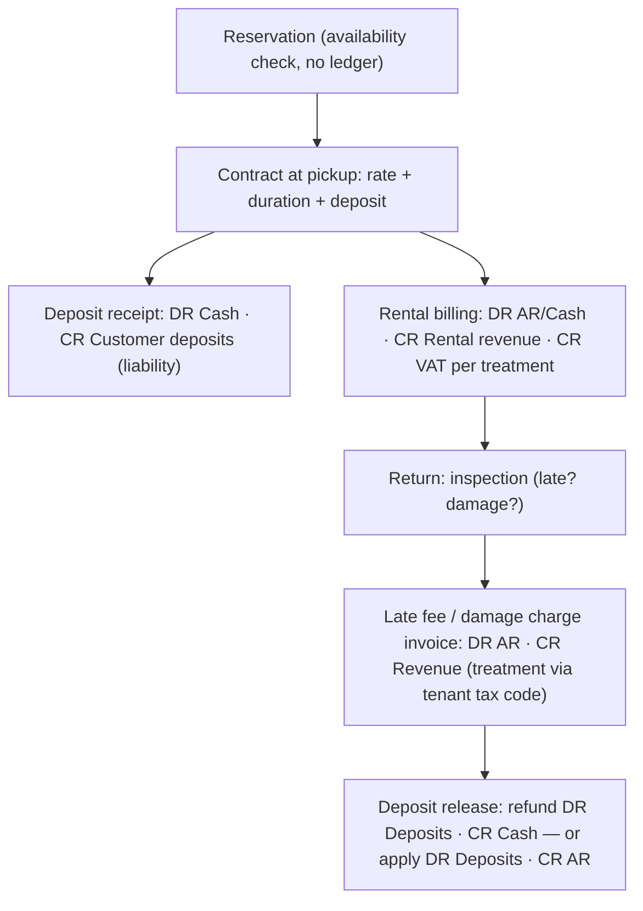

# Template: Rental & Logistics — `rental_logistics`

> **Status:** STABLE · **Owner:** Industry Solutions Architecture · **Updated:** 2026-11-10
> **Shipping status: SHIPPED with PHASE-035 (2026-11-10, migration
> `0047_industry_rental_logistics.sql` — the configuration-only 0044/0046 convention).**

Rent assets and move shipments: **rental contracts عقود الإيجار** with security
**deposits التأمين** and **late fees رسوم التأخير**, plus milestone-based
**shipment tracking تتبع الشحنات**. **SHIPPED with PHASE-035** (the gap-closure
phase that completed the CAPABILITY_MATRIX §3 pending-intake set — the PHASE-019
deferral decision record is closed; carrier-adapter feeds remain with the PHASE-023
integrations). Manifest schema:
[../README.md](../README.md) §3. Full car-rental workflow with accounting effects:
[../workflows/industry-workflows.md](../workflows/industry-workflows.md) (e).

## Target businesses

- Car rental offices (daily/weekly/monthly).
- Equipment & machinery rental (scaffolding, tools, event gear).
- Shipping agencies / freight forwarders (shipment milestones + freight invoicing).
- Furniture/appliance rental-to-rent chains.

## Manifest

The SHIPPED reconciled manifest (transcribed verbatim from
`RENTAL_LOGISTICS_TEMPLATE_MANIFEST` in
`packages/contracts/src/industry/templates.ts` — the same source the migration-0047
seed, the contracts constant, and the extracted
[manifests/manifest.rental_logistics.json](manifests/manifest.rental_logistics.json)
keep byte-equivalent under `canonicalManifestJson`):

```json
{
  "id": "industry.rental_logistics",
  "name": "Rental & Logistics",
  "name_ar": "التأجير والخدمات اللوجستية",
  "version": "1.0.0",
  "required_feature_keys": [
    "industry.template_engine", "crm.service_contracts", "crm.rental_contracts",
    "crm.contract_deposits", "crm.late_fees", "crm.recurring_billing",
    "distribution.shipment_tracking", "inventory.serial_tracking", "items.item_master",
    "partners.statements", "treasury.accounts"
  ],
  "default_modules_enabled": ["accounting", "partners", "items", "inventory", "sales",
    "treasury", "tax", "reporting", "crm", "distribution", "configuration"],
  "terminology_overrides": {
    "rental.contract": { "en": "Rental contract", "ar": "عقد الإيجار" },
    "rental.reservation": { "en": "Reservation", "ar": "الحجز" },
    "rental.deposit": { "en": "Security deposit", "ar": "مبلغ التأمين" },
    "rental.late_fee": { "en": "Late fee", "ar": "رسوم التأخير" },
    "rental.pickup": { "en": "Pickup (check-out)", "ar": "الاستلام" },
    "rental.return": { "en": "Return (check-in)", "ar": "الإرجاع" },
    "rental.inspection": { "en": "Damage inspection", "ar": "فحص الأضرار" },
    "rental.fleet": { "en": "Fleet", "ar": "الأسطول" },
    "rental.utilization": { "en": "Utilization", "ar": "نسبة الاستغلال" },
    "rental.grace_period": { "en": "Grace period", "ar": "مدة السماح" },
    "logi.shipment": { "en": "Shipment", "ar": "الشحنة" },
    "logi.waybill": { "en": "Waybill", "ar": "بوليصة الشحن" },
    "logi.milestone": { "en": "Milestone", "ar": "تحديث حالة الشحنة" }
  },
  "navigation_manifest": { "groups": [
    { "id": "rental", "label": { "en": "Rental", "ar": "التأجير" }, "order": 1, "items": [
      { "id": "reservations", "label": { "en": "Reservations", "ar": "الحجوزات" }, "target": "crm.rental_contracts", "feature_key": "crm.rental_contracts" },
      { "id": "contracts", "label": { "en": "Rental contracts", "ar": "عقود الإيجار" }, "target": "crm.contracts" },
      { "id": "fleet", "label": { "en": "Fleet & assets", "ar": "الأسطول والأصول" }, "target": "items.item_master" },
      { "id": "returns", "label": { "en": "Returns & inspections", "ar": "الإرجاع والفحص" }, "target": "crm.service_orders", "feature_key": "crm.service_orders" }
    ]},
    { "id": "logistics", "label": { "en": "Logistics", "ar": "الخدمات اللوجستية" }, "order": 2, "items": [
      { "id": "shipments", "label": { "en": "Shipments", "ar": "الشحنات" }, "target": "distribution.shipment_tracking", "feature_key": "distribution.shipment_tracking" }
    ]}
  ]},
  "workflow_policies": {
    "rental_deposit_required": true,
    "late_fee_after_grace_hours": 3,
    "late_fee_calculation": "daily_rate_based",
    "damage_charge_requires_inspection": true,
    "deposit_release_requires_manager_approval": true,
    "overdue_rental_blocks_new_reservation": true,
    "shipment_milestones_manual": true
  },
  "document_numbering_defaults": {
    "rental_contract": { "prefix": "RNT", "format": "RNT-{yyyy}-{seq:5}", "per_branch": true, "reserve_on_approval": true },
    "contract_invoice": { "prefix": "INV", "format": "INV-{yyyy}-{seq:6}", "per_branch": false, "reserve_on_approval": false },
    "receipt": { "prefix": "RCP", "format": "RCP-{yyyy}-{seq:6}", "per_branch": false, "reserve_on_approval": false },
    "payment": { "prefix": "PAY", "format": "PAY-{yyyy}-{seq:6}", "per_branch": false, "reserve_on_approval": false },
    "shipment": { "prefix": "SHP", "format": "SHP-{yyyy}-{seq:6}", "per_branch": false, "reserve_on_approval": false }
  },
  "inventory_policy_defaults": {
    "costing_method": "WAC", "default_track_batch": false, "default_track_expiry": false,
    "default_track_serial": true, "default_imei_tracking": false, "fefo_picking": false,
    "allow_negative_stock": false
  },
  "report_defaults": [
    { "report_key": "services.contract_revenue_schedule", "pinned": true, "dashboard": true, "default_period": "this_month" },
    { "report_key": "ar.aging", "pinned": true, "dashboard": true, "default_period": "this_month" },
    { "report_key": "inventory.valuation", "pinned": true, "dashboard": false, "default_period": "custom" }
  ],
  "onboarding_steps": [
    { "id": "coa_confirm", "title": { "en": "Confirm chart of accounts (customer deposits liability)", "ar": "تأكيد دليل الحسابات (التزامات تأمينات العملاء)" }, "required": true },
    { "id": "fleet", "title": { "en": "Register fleet/assets as serial items", "ar": "تسجيل الأسطول/الأصول كأصناف متسلسلة" }, "required": true },
    { "id": "rate_cards", "title": { "en": "Rental rate cards", "ar": "تعريفات التأجير" }, "required": true },
    { "id": "customers", "title": { "en": "Customers & ID documents", "ar": "العملاء ووثائق الهوية" }, "required": true },
    { "id": "deposit_policy", "title": { "en": "Deposit & late-fee policy", "ar": "سياسة التأمين ورسوم التأخير" }, "required": true },
    { "id": "first_contract", "title": { "en": "Run first rental contract end-to-end", "ar": "تنفيذ أول عقد إيجار كامل" }, "required": false },
    { "id": "shipments", "title": { "en": "Configure shipment milestones (logistics)", "ar": "تهيئة حالات الشحنات (اللوجستيات)" }, "required": false, "feature_key": "distribution.shipment_tracking" }
  ],
  "capability_prerequisites": {
    "rental_contracts": { "level": "REQUIRED", "feature_keys": ["crm.rental_contracts"], "available_from_phase": "PHASE-035" },
    "service_contracts": { "level": "REQUIRED", "feature_keys": ["crm.service_contracts"], "available_from_phase": "PHASE-019" },
    "recurring_billing": { "level": "REQUIRED", "feature_keys": ["crm.recurring_billing"], "available_from_phase": "PHASE-019" },
    "deposits_late_fees": { "level": "REQUIRED", "feature_keys": ["crm.contract_deposits", "crm.late_fees"], "available_from_phase": "PHASE-035" },
    "shipment_tracking": { "level": "REQUIRED", "feature_keys": ["distribution.shipment_tracking"], "available_from_phase": "PHASE-035" },
    "field_collections": { "level": "REQUIRED", "feature_keys": ["treasury.receipts_disbursements"], "available_from_phase": "PHASE-017" },
    "job_cards": { "level": "OPTIONAL", "feature_keys": ["sales.job_cards"], "available_from_phase": "PHASE-017" },
    "customer_price_tiers": { "level": "OPTIONAL", "feature_keys": ["items.price_lists", "distribution.customer_tiers"], "available_from_phase": "PHASE-017" },
    "commissions": { "level": "OPTIONAL", "feature_keys": ["sales.commissions"], "available_from_phase": "PHASE-017" },
    "route_planning": { "level": "OPTIONAL", "feature_keys": ["distribution.routes"], "available_from_phase": "PHASE-017" },
    "barcode_pos": { "level": "OPTIONAL", "feature_keys": ["pos.terminals", "pos.sales", "pos.receipts"], "available_from_phase": "PHASE-016" },
    "cashier_shifts": { "level": "OPTIONAL", "feature_keys": ["treasury.cashier_shifts"], "available_from_phase": "PHASE-016" },
    "pdc_notes": { "level": "OPTIONAL", "feature_keys": ["notes.received", "notes.pdc_calendar"], "available_from_phase": "PHASE-027" },
    "installment_terms": { "level": "OPTIONAL", "feature_keys": ["installments.plans", "installments.late_fees"], "available_from_phase": "PHASE-027" }
  }
}
```

**§J reconciliation notes (the 0025/0027/0039/0040/0044/0046 convention, applied at
the PHASE-035 intake):** `treasury.cash_accounts` (the pre-intake docs name) →
`treasury.accounts` (the LIVE catalog key); `partners.ar_aging` → `ar.aging` (the LIVE
registry key); the report pins land on LIVE keys only —
`services.contract_revenue_schedule` / `ar.aging` / `inventory.valuation` — while
`rental.fleet_utilization`, `rental.late_fee_register`, and
`logistics.shipment_status_board` have no live report keys, so register §J stays
closed: zero new report keys. The navigation's logistics `status_board` item merged
into the shipments item (one milestone-board capability); the rental group's items
carry `feature_key` guards so degraded plans hide them cleanly.

## Enabled features (exact keys)

| Feature key | Required? | Phase | Note |
|---|---|---|---|
| `crm.rental_contracts` | Required | PHASE-035 | Reservation→contract→return lifecycle; availability calendar (the §25 intake key) |
| `crm.contract_deposits`, `crm.late_fees` | Required | PHASE-035 | Liability-held deposits; grace-period fees (the §25 intake pair) |
| `crm.recurring_billing` | Required | PHASE-019 | Monthly rental billing for long contracts |
| `distribution.shipment_tracking` | Required | PHASE-035 | Manual milestones; carrier feeds PHASE-023 (the §25 intake key) |
| `inventory.serial_tracking` | Required | PHASE-010 | Each rentable unit is a serial item ("out on rent" status) |
| `crm.service_contracts` | Required | PHASE-019 | Contract base rental contracts extend |
| `treasury.accounts` | Required | PHASE-008 | Deposit receipt/release money movement |
| `distribution.routes` | Optional | PHASE-017 | Delivery/pickup round planning |
| `pos.sales`, `treasury.cashier_shifts` | Optional | PHASE-016 | Counter sales of supplies/accessories |

## Terminology overrides (sample)

| Term key | English | العربية | Note |
|---|---|---|---|
| `rental.contract` | Rental contract | عقد الإيجار | One asset rental engagement |
| `rental.reservation` | Reservation | الحجز | No ledger effect |
| `rental.deposit` | Security deposit | مبلغ التأمين | Liability until release |
| `rental.late_fee` | Late fee | رسوم التأخير | After grace period |
| `rental.pickup` | Pickup (check-out) | الاستلام | Asset goes "out on rent" |
| `rental.return` | Return (check-in) | الإرجاع | Inspection step |
| `rental.fleet` | Fleet | الأسطول | Serial-asset registry |
| `rental.utilization` | Utilization | نسبة الاستغلال | On-rent days ÷ available days |
| `logi.shipment` | Shipment | الشحنة | Tracked consignment |
| `logi.waybill` | Waybill | بوليصة الشحن | Printed per pack rules where applicable |

## Default navigation (sample)

| EN | AR | Target | Feature key |
|----|----|--------|-------------|
| Reservations | الحجوزات | `crm.rental_contracts` | `crm.rental_contracts` |
| Rental contracts | عقود الإيجار | `crm.contracts` | — |
| Fleet & assets | الأسطول والأصول | `items.item_master` | — |
| Returns & inspections | الإرجاع والفحص | `crm.service_orders` | `crm.service_orders` |
| Shipments (incl. the status board) | الشحنات | `distribution.shipment_tracking` | `distribution.shipment_tracking` |

## Signature workflow — car rental (compact)



Numbered steps and per-step journals:
[../workflows/industry-workflows.md](../workflows/industry-workflows.md) §e.

## Inventory behavior defaults

| Setting | Default | Notes |
|---|---|---|
| Costing method | WAC | Asset carrying value (not depreciation — see limitations) |
| Serial tracking | On | One serial item per rentable unit |
| Batch/expiry | Off | |
| "Out on rent" status | On | Asset stays in inventory, flagged unavailable |
| Depreciation schedules | Out of scope | FR-ACC-009 is priority 3; carrying value is cost |
| Negative stock | Forbidden | |

## Document types emphasized

| Document | Arabic | Numbering default | Policy |
|---|---|---|---|
| Rental contract | عقد الإيجار | `RNT-{yyyy}-{seq:5}` | Number reserved at approval (pickup) |
| Rental invoice / late-fee invoice | فاتورة الإيجار / فاتورة رسوم التأخير | `INV-{yyyy}-{seq:6}` | Standard invoice lifecycle |
| Deposit receipt / release | سند قبض التأمين / سند صرف التأمين | `RCP-` / `PAY-` | Liability movement, never revenue |
| Shipment record | سجل الشحنة | `SHP-{yyyy}-{seq:6}` | Milestones; freight billed via invoices |

## Reports emphasized

`services.contract_revenue_schedule` (dashboard), `ar.aging` (dashboard),
`inventory.valuation` — the LIVE registry keys the shipped manifest pins; see
[../reports/README.md](../reports/README.md).

## Out of scope for this template

- Vehicle GPS/fleet telematics and geofencing.
- OTA/booking-channel integrations (external adapters only, PHASE-023).
- Asset depreciation scheduling (FR-ACC-009, priority 3 — not part of this template).
- Customs brokerage documentation systems (milestones + invoicing only).

## Known limitations

- **Carrier status feeds require PHASE-023 adapters**; until then shipment milestones are
  manually maintained (the model is ready for adapter-written milestones).
- Late-fee calculation is calendar/daily-rate based; hour-level proration beyond the
  configured grace period is a policy value, not a rules engine.
- Tax treatment of damage-compensation and late-fee lines intentionally resolves through
  the tenant's tax code and jurisdiction pack — the platform asserts no treatment
  ([../../localization/TAX_ENGINE.md](../../localization/TAX_ENGINE.md) §1).
- Fleet assets carry cost value without depreciation until fixed-asset schedules ship;
  utilization reports use availability status, not book value.
